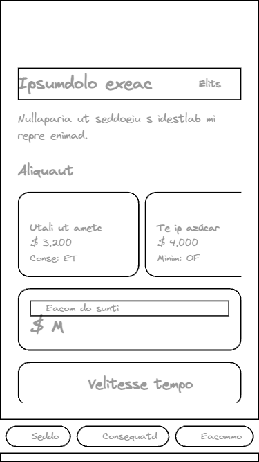
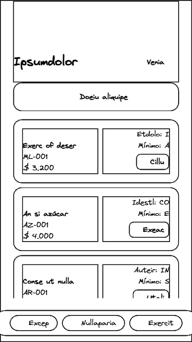
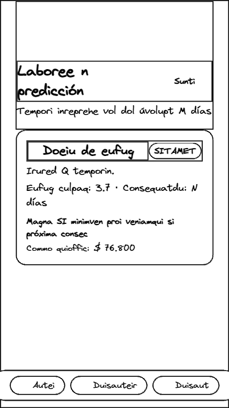

# Diseño de Pantallas y Modelo de Base de Datos

## 1. Wireframes de las tres pantallas

Las imágenes utilizadas corresponden a los bocetos incluidos en `docs/data/`.

### 1.1 Registrar venta



Esta pantalla permite registrar una venta con el menor número posible de acciones:

1. Seleccionar el producto.
2. Ajustar o escribir la cantidad.
3. Revisar el total.
4. Confirmar la venta.

Por esta razón, una venta puede completarse en máximo cuatro toques.

Los principales elementos son:

- Buscador o filtro rápido de productos.
- Tarjetas con nombre y precio.
- Campo de cantidad.
- Controles para aumentar o disminuir unidades.
- Total calculado automáticamente.
- Botón grande para confirmar la venta.
- Pestaña fija de Venta, Inventario y Alertas.

La cantidad debe ser un entero positivo y no puede superar el stock disponible. La confirmación registra el historial y descuenta el stock.

### 1.2 Inventario



Esta pantalla muestra la información operativa de cada producto:

- Nombre.
- Código.
- Precio de venta.
- Stock actual.
- Stock mínimo.

Incluye acciones para:

- Crear un nuevo producto.
- Consultar los productos existentes.
- Registrar mercancía recibida y sumar unidades al stock.

Un producto se identifica visualmente como stock bajo cuando su stock actual es menor o igual al mínimo.

### 1.3 Alertas y predicción



Esta pantalla presenta la información calculada a partir del historial de ventas:

- Promedio diario de ventas.
- Días estimados hasta el agotamiento.
- Estado urgente.
- Cantidad sugerida para compra semanal.

La sugerencia permite visualizar cuánto pedir para abastecer el producto durante la próxima semana.

## 2. Relación entre las pantallas

Las tres pantallas forman una sola operación:

```text
Producto → Venta → Stock actualizado → Predicción → Alerta de compra
```

Los datos compartidos son:

- Los productos registrados en Inventario.
- Las ventas realizadas en Registrar Venta.
- Los cálculos obtenidos desde el historial para Alertas.

## 3. Esquema relacional


El modelo contiene dos tablas relacionadas.

### 3.1 Tabla Productos

| Campo | Tipo | Restricción |
|---|---|---|
| `id` | INTEGER | PRIMARY KEY AUTOINCREMENT |
| `codigo` | TEXT | UNIQUE, NOT NULL |
| `nombre` | TEXT | NOT NULL |
| `precio_venta` | REAL | NOT NULL |
| `stock_actual` | INTEGER | NOT NULL |
| `stock_minimo` | INTEGER | NOT NULL |

### 3.2 Tabla Historial_Ventas

| Campo | Tipo | Restricción |
|---|---|---|
| `id` | INTEGER | PRIMARY KEY AUTOINCREMENT |
| `fecha` | TEXT | NOT NULL |
| `id_producto` | INTEGER | FOREIGN KEY, NOT NULL |
| `cantidad` | INTEGER | NOT NULL |
| `total_venta` | REAL | NOT NULL |

## 4. Relación entre tablas

Un producto puede aparecer en muchas ventas, pero cada registro de venta pertenece a un solo producto.

```text
Productos (1) ← genera → (0..*) Historial_Ventas
```

La relación se implementa mediante:

```sql
Historial_Ventas.id_producto
REFERENCES Productos.id
```

## 5. Operaciones principales

### 5.1 Registrar venta

```text
Buscar o seleccionar producto
Escribir cantidad
Validar cantidad y stock
Insertar registro en Historial_Ventas
Descontar unidades de Productos.stock_actual
```

### 5.2 Añadir mercancía

```text
Seleccionar producto
Escribir cantidad recibida
Sumar cantidad a Productos.stock_actual
```

### 5.3 Calcular alerta

```text
Ventas siete días = sumar cantidad vendida del producto
Promedio diario = ventas siete días / 7
Días restantes = stock actual / promedio diario

Si stock actual <= mínimo o días restantes <= 3:
    Marcar producto como urgente
    Calcular compra semanal sugerida
```
